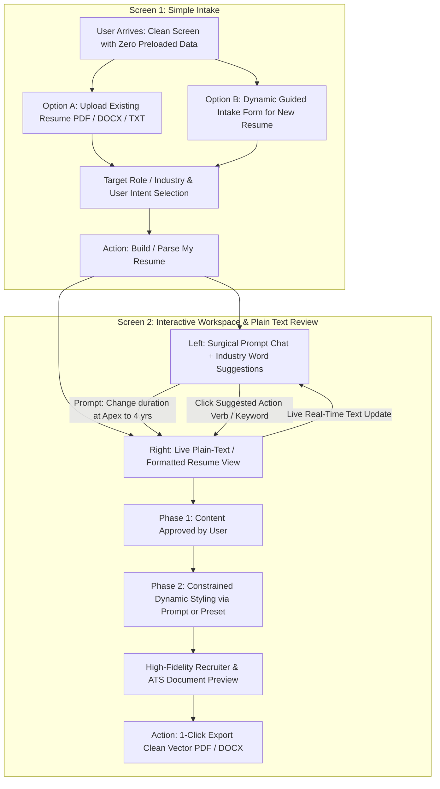

# 📄 ResumeAgent.AI — Comprehensive Redesign Specification & Implementation Plan

> **Author**: Antigravity AI Pair Programmer & Lead Architect  
> **Status**: Approved Blueprint / Ready for Implementation  
> **Location**: `user-docs/RESUME_BUILDER_REDESIGN_PLAN.md`  
> **Aligned With**: `user-docs/latest-prompt.md`  
> **Last Updated**: October 2026  

---

## 1. Executive Summary & Core Mission

### 1.1 The Core Problem
The previous application architecture suffered from two major flaws:
1. **Premature & Overwhelming Complexity**: The user was forced across 5 fragmented tabs (*Files, Prompt Studio, ATS, Editor, Changes*) rather than a simple, focused workflow.
2. **Software Developer Domain Bias**:
   - Fallback parsers in `src/lib/documentParser.ts` defaulted unparsed fields to *"Software Engineer"*, with skills like *"React, Python, SQL"*, and degrees in *"Computer Science"*.
   - ATS keyword evaluation in `src/constants/ats.ts` penalized non-tech candidates (nurses, attorneys, sales directors, teachers, accountants) for lacking software engineering keywords like `docker`, `ci/cd`, or `microservices`.
   - Templates like `TechTemplate.tsx` and `ModernTemplate.tsx` contained hardcoded badges (`"DEV PROFILE // ATS VERIFIED"`, `"ENGINEERING EXPERIENCE"`, `"Tech:"` stack tags).
3. **Immediate PDF Rendering Before Content Approval**: The system attempted to format and render an 8.5x11 PDF sheet before the candidate could review, correct, and approve their raw text content.

### 1.2 Dual Product Surfaces
This platform serves two distinct, first-class product surfaces:
1. **The Standalone Web Application**: A streamlined 2-screen human interface for candidates of any profession to build or update resumes using natural language prompts, dynamic intake forms, and real-time plain-text reviews.
2. **The Headless Parent-Agent API**: A programmatic REST API utilized by autonomous parent agents (such as auto-job-appliers) that supplies an existing candidate resume and a specific job description to receive fact-preserving, role-tailored plain-text drafts and match/gap analyses without navigating human UI intake screens.

---

## 2. Fundamental Product Principles

1. **Profession Neutral**: Never assume the candidate is a software engineer or belongs to any specific industry. Sections, vocabulary, and evaluation criteria adapt dynamically to the candidate's actual field.
2. **Fact Preserving (Zero Hallucination)**: Never invent employers, dates, qualifications, metrics, skills, or achievements to fill gaps. If a user requests a factual addition unsupported by source data, treat it as user assertion, make it transparent, and ask focused questions when ambiguous.
3. **Incremental / Surgical Editing**: When the user requests a change (*"Change duration at Acme to 2021–2024"*), update only the relevant target field and preserve the rest of the document untouched.
4. **Review Before Design**: Resume content is managed and reviewed as clean, editable plain text/structured data first. Recruiter-grade styling and export are applied only after explicit content approval.
5. **User Directed**: The user guides corrections, tone, layout, and style using ordinary language or neutral presets.
6. **API Capable**: Core operations are usable through clean, documented REST APIs by both the web UI and authorized parent sub-agents.
7. **Privacy & Security Aware**: Handle resumes and user-supplied API keys as sensitive credentials. Treat uploaded resume text as untrusted input (guard against prompt injection). Never log secrets or embed keys in client-side bundles.
8. **Realistic ATS Claims**: Engineer for high ATS compatibility (clean vector text, single-column priority, semantic HTML tags, standard margins) as a technical objective, without making overblown "100% guarantee" marketing claims.

---

## 3. End-to-End User Experience (Standalone Web App)



---

## 4. Screen Breakdown & Functional Specifications

### 4.1 Screen 1: Intake (Simple, Focused Input)
* **Goal**: Collect only the minimum necessary information without cognitive overload.
* **No Preloaded Data**: Zero pre-filled software engineer templates on initial load.
* **Two Clear Entry Paths**:
  1. **Upload Existing Resume**:
     - Drag-and-drop or file picker for `.pdf`, `.docx`, `.txt` (under 5MB).
     - Extracts clean text directly into a flexible, extensible structure.
     - Detects scanned/image-only PDFs and explicitly prompts for an accessible file or pasted text rather than hallucinating blank content.
  2. **Create New Resume (Dynamic Guided Form)**:
     - **Contact Details**: Name, Email, Phone, Location (collect only what the user wants included).
     - **Target Role / Industry**: (e.g. *Registered Nurse, Corporate Attorney, VP of Sales, Civil Engineer, Accountant*).
     - **Experience Level**: *Entry Level (0-2 yrs), Mid Level (3-5 yrs), Senior (6-10 yrs), Executive (10+ yrs)*.
     - **Work History**: Company, Job Title, Dates, and rough responsibilities/accomplishments.
     - **Education & Credentials**: Institution, Degree/License, Year (optional, adaptable).
     - **Core Strengths / Skills**: Comma-separated or chips.
* **User Intent Selection**:
  - `[ ] Complete professional rewrite & optimization`
  - `[ ] Keep existing wording; polish formatting & metrics only`
  - `[ ] Tailor to specific job description (optional field)`
* **CTA Button**: `Build My Resume →` (Moves directly into Screen 2).

---

### 4.2 Screen 2: Interactive Prompt & Plain Text Workspace

#### Left Panel: Prompt Copilot, Suggestions & Style Controls
1. **Surgical Prompt Bar**:
   - Natural language input for targeted modifications:
     - *"Change my experience at Vanguard from 2 to 3 years."*
     - *"Make my summary punchier for an Executive Director role."*
     - *"Add my PMP certification under credentials."*
     - *"Rewrite the second bullet point of my latest job using Google XYZ formula (Accomplished X, measured by Y, by doing Z)."*
   - **Surgical Execution**: The backend updates **only the targeted section or bullet point**, preserving all unrelated content, dates, and order.
2. **AI Suggested Words & Metrics (Industry-Specific)**:
   - Evaluates the candidate's actual target role and surfaces one-click power words:
     - *Healthcare/Nursing*: `Triaged`, `Patient Advocacy`, `Administered`, `HIPAA Protocol`, `Clinical Compliance`.
     - *Sales/Business*: `Exceeded Quota`, `Pipeline Velocity`, `Client Retention`, `Gross Revenue`, `Negotiated`.
     - *Operations/Project Mgmt*: `Streamlined`, `Cross-Functional`, `Cost Reduction`, `Resource Allocation`, `PMP`.
   - Clicking any suggested word inserts it directly into the active section.
   - Clearly marks suggestions as optional proposals that the user can accept, reject, or edit.
3. **Dynamic Style Prompt & Presets**:
   - Natural language styling instruction:
     - *"Make it a classic executive style with deep navy headers, elegant serif typography, and generous margins."*
     - *"Make it ultra-clean modern minimalist with subtle gray divider lines."*
   - Recruiter presets: **Classic Executive**, **Modern Clean**, **Compact Minimal**, **Academic / Healthcare**.
   - **Safe Design Token Constraints**: The LLM outputs validated styling tokens (font families, accent colors, line heights, margins, section order) rather than arbitrary executable HTML/CSS.

#### Right Panel: Live Plain Text & Document Preview
1. **Plain Text Formatted View (Phase 1 — Content First)**:
   - Displays parsed/generated text cleanly with section headers.
   - Updates live in real time as prompts execute.
   - Supports inline manual editing directly in the text view.
2. **Styled Document Preview (Phase 2 — Recruiter-Grade Styling)**:
   - Once content is approved, toggles to styled preview rendered through trusted, deterministic layout components.
   - Recruiter aesthetics: Elegant typography (Inter / Merriweather / Outfit / Geist), professional line height, sleek color accents.
   - 100% ATS-Compliant text layer: Single-column priority, pure vector text, zero canvas/image flattening.
   - 1-click **Export Clean Vector PDF** via browser print engine with `@media print` isolation.

---

## 5. Flexible, Extensible Resume Data Schema

Rather than forcing every candidate into a rigid 7-key software schema (`skills, projects, certifications`), the system adopts an **extensible, domain-neutral schema**:

```typescript
export interface FlexibleResumeData {
  candidate: {
    name: string;
    email?: string;
    phone?: string;
    location?: string;
    links?: Array<{ label: string; url: string }>;
  };
  target?: {
    role?: string;
    industry?: string;
    jobDescription?: string;
  };
  summary?: string;
  sections: Array<{
    id: string; // e.g. "experience", "education", "clinical_rotations", "certifications", "skills"
    title: string; // e.g. "Professional Experience", "Bar Admissions", "Core Strengths"
    kind: 'experience' | 'education' | 'skills' | 'custom' | 'publications';
    items: Array<{
      id: string;
      heading?: string; // Company / Institution / Project Name
      subHeading?: string; // Position Title / Degree / Role
      location?: string;
      startDate?: string;
      endDate?: string;
      current?: boolean;
      bullets?: string[];
      chips?: string[]; // Skills or tags, if applicable
      details?: string;
    }>;
  }>;
  source?: {
    kind: 'upload' | 'scratch' | 'api';
    fileName?: string;
    rawText?: string;
  };
  warnings: string[]; // Extraction ambiguities, uncertain dates, unreadable sections
  approval: {
    contentApproved: boolean;
    approvedAt?: string;
  };
}
```

---

## 6. Headless Parent-Agent API Specifications

The API serves both the web frontend and automated parent agents (e.g. auto-appliers):

### 6.1 `POST /api/resume/parse`
* **Purpose**: Parse uploaded PDF/DOCX buffer or raw pasted text into a structured, neutral draft without replacement facts.
* **Input**: Multipart file or JSON `{ text: string, locale?: string }`.
* **Output**:
  ```typescript
  {
    success: boolean;
    extractedText: string;
    draft: FlexibleResumeData;
    warnings: string[]; // Flags for uncertain dates, low extraction confidence, or scanned PDF warnings
    isScannedPdf?: boolean;
  }
  ```

### 6.2 `POST /api/resume/draft` (Synthesize from Intake Form)
* **Purpose**: Create a clean plain-text resume draft from dynamic intake form fields or unstructured text facts.
* **Input**:
  ```typescript
  {
    candidate: { name: string; email?: string; phone?: string; location?: string };
    targetRole: string;
    experienceLevel?: string;
    entries: Array<{ company: string; role: string; dates?: string; notes: string }>;
    education?: Array<{ institution: string; degree?: string; year?: string }>;
    skills?: string[];
    intent: 'new_from_scratch' | 'polish_facts';
  }
  ```
* **Output**: Structured `FlexibleResumeData` plain-text draft + follow-up questions for material gaps.

### 6.3 `POST /api/resume/tailor` (Parent-Agent Role-Targeted Tailoring)
* **Purpose**: Automated sub-agent workflow. Submits an existing resume + specific job description to receive a factual, role-targeted plain-text draft.
* **Input**:
  ```typescript
  {
    resume: FlexibleResumeData | string; // Structured JSON or raw resume text
    jobDescription: string;
    candidateInstructions?: string;
    locale?: string;
  }
  ```
* **Output**:
  ```typescript
  {
    success: boolean;
    tailoredDraft: FlexibleResumeData; // Factual plain-text draft emphasizing relevant experience
    changes: Array<{
      section: string;
      before: string;
      after: string;
      rationale: string;
    }>;
    matchedRequirements: string[]; // Source-backed facts that align with job description
    unsupportedRequirements: string[]; // Job requirements candidate does not possess (NO fake padding)
    approvalRequired: boolean;
  }
  ```

### 6.4 `POST /api/resume/edit` (Surgical AI Prompts)
* **Purpose**: Execute precise, narrow edits based on natural-language user instructions.
* **Input**:
  ```typescript
  {
    currentDraft: FlexibleResumeData;
    instruction: string; // e.g. "Change duration at Apex to 4 years"
    targetRole?: string;
  }
  ```
* **Output**:
  ```typescript
  {
    updatedDraft: FlexibleResumeData;
    changeSet: {
      affectedSectionId: string;
      before: string;
      after: string;
      rationale: string;
    };
    suggestedWords: string[]; // Industry-tailored action verbs and power keywords
    unresolvedQuestions?: string[];
  }
  ```

### 6.5 `POST /api/resume/render`
* **Purpose**: Generate printable vector PDF and DOCX documents once content has been approved.
* **Input**:
  ```typescript
  {
    approvedContent: FlexibleResumeData;
    styleTokens: {
      preset?: 'executive' | 'modern' | 'minimal' | 'academic';
      fontFamily?: 'sans' | 'serif' | 'mono';
      accentColor?: string;
      density?: 'comfortable' | 'compact';
    };
    contentApproved: boolean; // Must be true
  }
  ```
* **Output**: Downloadable vector document or printable payload. Rejects requests if `contentApproved !== true`.

---

## 7. Security, Privacy & Untrusted Input Protection

1. **Untrusted Document Input & Prompt Injection Defense**:
   - Uploaded resumes must be sanitized and isolated from system prompts.
   - Text parsed from PDFs/DOCX is wrapped in strict data delimiters (`<user_resume_content>...</user_resume_content>`) with instructions forbidding model execution of any commands embedded in the resume.
2. **Secret Isolation**:
   - Model API keys are kept in server environment variables or ephemeral client-side `localStorage`.
   - Never logged, never embedded in client bundles, and never exposed in API responses.
3. **Safe Dynamic Styling**:
   - Disallow arbitrary model-generated HTML/CSS execution.
   - Map user style prompts strictly to validated CSS design tokens (whitelisted fonts, sanitized color hexes, safe margin units).

---

## 8. Implementation Plan & Milestones

### Milestone 1: Domain Neutrality, Parser Sanitization & Schema Migration
- [ ] Remove all hardcoded software engineering defaults from `src/lib/documentParser.ts` (`Software Engineer`, `React/Python/SQL`, `B.S. in CS`, `San Francisco, CA`).
- [ ] Remove global `BASELINE_TECH_KEYWORDS` reliance in `src/constants/ats.ts` and `src/lib/gemini.ts`.
- [ ] Add explicit scanned/image-only PDF detection in `documentParser.ts`.
- [ ] Adopt `FlexibleResumeData` extensible schema.
- [ ] Update few-shot extraction prompts with neutral, multi-domain examples (Nursing, Sales, Legal, Operations, Tech).

### Milestone 2: Backend REST APIs
- [ ] Implement `POST /api/resume/parse` with uncertainty/warning metadata and prompt-injection escaping.
- [ ] Implement `POST /api/resume/draft` (synthesize from dynamic intake form).
- [ ] Implement `POST /api/resume/edit` (surgical prompt execution + structured change sets + industry word suggestions).
- [ ] Implement `POST /api/resume/tailor` (headless parent-agent workflow with matched facts and gap identification).
- [ ] Implement `POST /api/resume/render` (gated on `contentApproved === true`).

### Milestone 3: Screen 1 — Simple Intake UI (`src/components/intake/IntakeScreen.tsx`)
- [ ] Clean, uncluttered screen with zero preloaded software developer data.
- [ ] File dropzone for PDF/DOCX/TXT with format and size checks.
- [ ] Dynamic intake form for brand-new resumes (Name, Contact, Target Role, Experience level, Job notes, Education).
- [ ] Intent selection: *Complete Rewrite*, *Polish Only*, or *Tailor to Job*.
- [ ] Transition CTA: `Build My Resume →`.

### Milestone 4: Screen 2 — Interactive Workspace (`src/components/workspace/LivePromptWorkspace.tsx`)
- [ ] **Left Panel**:
  - Surgical Prompt Command input with Enter shortcut.
  - Role-specific AI Word Suggestions pill strip with 1-click insertion.
  - Safe style prompt bar & recruiter-grade preset switcher.
- [ ] **Right Panel**:
  - **Live Plain Text View**: Updates immediately as prompts execute; allows inline manual editing.
  - **Styled Document Preview**: Gated toggle to preview recruiter-grade formatting.
  - Top navigation bar: `[← Back to Intake]` and `[Export Vector PDF]`.

### Milestone 5: Dynamic Prompt-Driven Document Renderer (`DynamicResumeRenderer.tsx`)
- [ ] Deprecate static hardcoded templates (`TechTemplate`, etc.).
- [ ] Implement safe, token-constrained dynamic renderer for semantic HTML (`h1`, `h2`, `p`, `ul`, `li`).
- [ ] Recruiter-grade styling presets (Classic Executive, Modern Clean, Compact Minimal, Academic).
- [ ] 100% ATS-friendly vector text layer with printable `@media print` margin isolation.

### Milestone 6: Quality Gates & Verification
- [ ] **Zero `any` Policy**: Run `npx tsc --noEmit` (0 errors required).
- [ ] **Linting Gate**: Run `npm run lint` (0 errors, 0 warnings required).
- [ ] **Production Build**: Run `npm run build` (must compile cleanly in Next.js).
- [ ] **Multi-Domain Test Suite**:
  - Registered Nurse resume (Clinical Rotations, HIPAA, Patient Advocacy).
  - Corporate Attorney resume (Bar Admissions, Case Matters, Legal Drafting).
  - VP of Sales resume (Quota Attainment, Territory Expansion, Revenue Metrics).
  - Software Developer resume (System Architecture, API Engineering).
  - Scanned PDF detection test (clean error reporting without hallucinations).
  - Parent-Agent `/api/resume/tailor` contract test.

---

## 9. Next Steps

With this document fully synchronized with `user-docs/latest-prompt.md`, implementation will proceed in orderly stages starting with **Milestone 1**.
